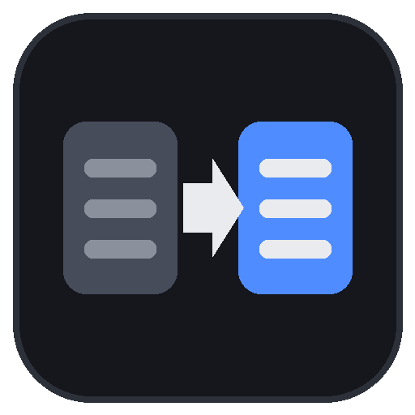

<p align="center"></p>

# CoD Asset Porter

Move models, animations, textures and sounds between Call of Duty games' mod tools.
Add your exported files, pick the game they're going into, click **Convert**, and get files,
plus a ready-made GDT, that the target game's tools import.

**Targets:** Call of Duty 4 · World at War · Black Ops 1 · Black Ops 2 (Plutonium, via OpenAssetTools) · Black Ops 3

> CoD Asset Porter works on files you've already exported (with Greyhound, Wraith,
> OpenAssetTools, etc.) or source files from the official mod tools. It doesn't read
> game archives.

## Download

Grab `CoD-Asset-Porter-windows.zip` from the [Releases](../../releases) page, unzip it, and run
**CoD Asset Porter.exe**. You don't need to install anything.

## How to use it

1. **Add files** or **Add folder**, or drag them onto the list. Folders are scanned for
   everything supported, including any `.gdt` that came with a port pack.
2. Click the game you're converting **to**.
3. Choose where the files go:
   * **Put files straight into my &lt;game&gt; folder**: the app finds your Steam installs, so
     everything lands in `model_export`, `xanim_export`, `texture_assets`, `source_data`, etc.
   * Or pick any folder and copy its contents into the game folder later.
4. Optionally rename the **Pack name**. That's the subfolder (and GDT) your files go in.
5. Click **Convert**. The log says what happened to every file and what to do next.
   A copy is saved as `port_log_<pack>.txt`.

### What it reads

| Type       | Formats |
|------------|---------|
| Models     | `.xmodel_export`, `.xmodel_bin` (BO3), `.semodel`, `.cast` |
| Animations | `.xanim_export` (+ its `.NT_EXPORT` notetracks), `.xanim_bin` (BO3), `.seanim`, `.cast` |
| Textures   | `.png`, `.dds`, `.tga`, `.tif`, `.jpg`, `.bmp` |
| Sounds     | `.wav` (8/16/24/32-bit, float), `.flac`, `.ogg`, `.mp3` |
| Extras     | `.gdt` files from port packs, Wraith/Greyhound `*_images.txt` |

### What it writes

|                | CoD4 / WaW / BO1 | Black Ops 3 | Black Ops 2 (OpenAssetTools) |
|----------------|------------------|-------------|------------------------------|
| Models         | `model_export/<pack>/*.xmodel_export` | `model_export/<pack>/*.xmodel_bin` | `model_export/<pack>/*.glb` + `xmodel/*.json` |
| Animations     | `xanim_export/<pack>/*.xanim_export` | `xanim_export/<pack>/*.xanim_bin` | not supported yet |
| Textures       | `texture_assets/<pack>/*.tga` (power-of-two, max 2048) | `texture_assets/<pack>/*.tif` | `images/*.dds` |
| Sounds         | `raw/sound/<pack>/*.wav` (16-bit 44.1 kHz) | `sound_assets/<pack>/*.wav` (16-bit 48 kHz) | `sound/<pack>/*.wav` |
| Asset list     | `source_data/<pack>.gdt` | `source_data/<pack>.gdt` | n/a |

The GDT holds an entry for every model (rigid / animated / viewhands), every material with its
color, normal, specular and gloss maps filled in, every image (BO3), and every animation linked
to the model it belongs to.

### What it fixes along the way

* **Textures:** reads what each material uses from the model, from the pack's own GDT, or from
  `*_images.txt`, and finds those images near the model.
* **Normal maps:** rebuilds two-channel normal maps (X/Y only) into full RGB.
* **Skinning:** trims bone weights to what the target game takes and renormalizes them.
* **Clean-up:** removes broken triangles and unused materials, and makes names tool-safe.
* **Animations:** bakes `.seanim`/`.cast` onto the right skeleton, matched by the pack's GDT or by bone names.

## Per-game notes

* **CoD4 / WaW / BO1:** open Asset Manager, then *File > Open > source_data\\&lt;pack&gt;.gdt*,
  select everything and press **Convert**. Add the assets to your mod's `mod.csv` as usual.
* **Black Ops 3:** the GDT shows up in APE under `source_data`. Add the assets to your zone
  file and link from the Launcher.
* **Black Ops 2:** models are built with [OpenAssetTools](https://github.com/Laupetin/OpenAssetTools).
  Point its Linker at the output folder. BO2 has no material pipeline yet, so model
  materials must use names of materials that already exist in BO2 (or ones you make with
  OAT). OAT can't load source animations yet, so animations are skipped for BO2.

## Animations from `.seanim` / `.cast`

These store only the bones that move, so they need the skeleton of the model they belong to.
Add the model with its animations (the app picks the best match), or set
**Skeleton for animations** to that model.

## Command line

```
"CoD Asset Porter.exe" --game waw --into-game "C:\exports\my_weapon"
python app.py --game bo3 --out "C:\ported" --pack my_weapon "C:\exports\my_weapon"
python app.py --game bo1 --rig viewhands.semodel reload.seanim
```

Options: `--game {cod4,waw,bo1,bo2,bo3}`, `--out`, `--into-game`, `--pack`, `--rig`, `--scale`.

## Running from source / building the exe

Needs Python 3.10+.

```
run.bat          # first run installs the libraries, then opens the app
build.bat        # runs the tests and builds dist\CoD Asset Porter.exe
python -m unittest discover -s tests
```

Every push runs the tests on Windows and Linux. Pushing a tag like `v1.0.0` builds the .exe and
attaches it to a GitHub release.

## Credits

Format details come from these open projects. No code is copied from them.

* [PyCoD](https://github.com/SE2Dev/PyCoD) (MIT): xmodel/xanim export and BO3 binary layouts
* [Cast](https://github.com/dtzxporter/cast) (MIT): the Cast format
* [SEModel](https://github.com/dtzxporter/SEModel-Docs) / [SEAnim](https://github.com/dtzxporter/SEAnim-Docs) docs
* [OpenAssetTools](https://github.com/Laupetin/OpenAssetTools): BO2 model conventions

## Legal

Not affiliated with or endorsed by Activision. Call of Duty is a trademark of Activision
Publishing, Inc. Game assets belong to their owners, so only port and share what you're allowed to.
This tool is released under the MIT license.
